<p align="center">
  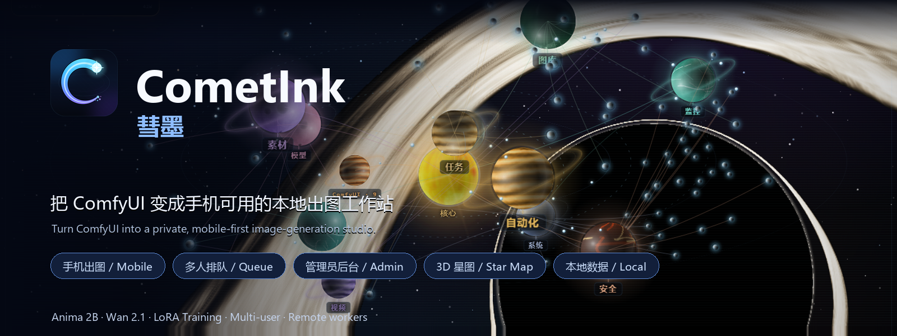
</p>

<p align="center">
  <b>把 ComfyUI 变成一台可以用手机浏览器操作的本地出图工作站。</b><br>
  <b>Turn ComfyUI into a private, mobile-first image-generation studio.</b><br>
  手机出图 · 多人排队 · 管理员后台 · LoRA 训练 · 3D 接口星图<br>
  Mobile generation · Fair queue · Admin console · LoRA training · 3D API star map
</p>

<p align="center">
  
  
  
  
  
</p>

**中文** — CometInk 彗墨把 ComfyUI 包装成一台局域网内的工作站：手机浏览器写提示词、排队出图、看图库；管理员在同一个页面管理账号、限额、流量、队列、算力节点、LoRA 训练和日志。图片、账号和日志默认都留在本机，不需要注册云账号。

> **English** — CometInk turns ComfyUI into a small private studio on your LAN: write prompts, queue generations, and browse the gallery from a phone browser, while the admin manages accounts, quotas, traffic, the queue, worker nodes, LoRA training, and audit logs from the same page. Images, accounts, and logs stay on your machine; no cloud account is required.

> 以下截图来自演示环境，作品由 CometInk 调用 Anima 2B / Juggernaut XI 生成，仅用于界面展示。  
> Screenshots come from a demo environment; the artwork was generated through CometInk with Anima 2B / Juggernaut XI and is shown for UI demonstration only.

---

## 为什么是彗墨 / Why CometInk

| 主题 / Topic | 中文 | English |
|---|---|---|
| 手机优先 / Mobile first | 不用装 App。手机连上电脑热点，打开网页就能写提示词、看图库、排队和取消任务；也可以添加到主屏幕当 PWA。 | No app install. Join the PC hotspot, open the page, and write prompts, browse the gallery, queue or cancel jobs. It also works as a home-screen PWA. |
| 多人共用 / Multi-user | 多账号、每日限额、功能开关、流量统计、活动/安全日志；按“最久未服务优先”公平排队，不会一个人把显卡塞满。 | Multiple accounts, daily quotas, feature switches, traffic accounting, and activity/security logs. The least-recently-served fair queue keeps one user from monopolising the GPU. |
| 管理员可控 / Admin control | 后台集中管理账号、限额、队列、算力节点、模型、训练和日志；普通账号看不到后台入口。 | A single admin console for accounts, limits, queue, workers, models, training, and logs. Normal accounts never see the admin entry point. |
| 数据在本机 / Local data | 图片、账号、日志和训练数据默认都在本机；没有开发者服务器。 | Images, accounts, logs, and training data stay local by default. There is no developer-operated server. |

它不是另一个 ComfyUI 皮肤，而是把“出图这件事”补上日常使用需要的那一层：输入、执行、输出和管理。  
It is not another ComfyUI skin; it adds the day-to-day layer around generation: input, execution, output, and administration.

---

## 界面 / Interface

### 出图工作台 / Generator

**中文** — 左栏写提示词、选模式/画幅/底模/画风，右栏实时显示进度和结果。中文可以直接写，系统会自动翻成英文；也可以点「看译文」检查模型实际收到的内容。

> **English** — The left column holds the prompt, mode, aspect, checkpoint, and style; the right column shows live progress and results. Write in Chinese and let the translator convert it to English, or open “View translation” to inspect exactly what the model receives.

<p align="center">
  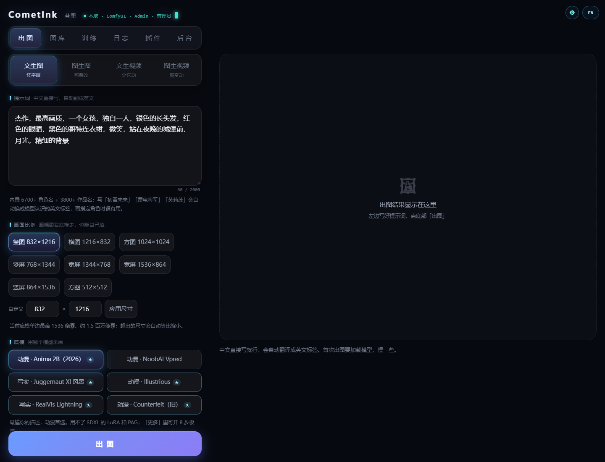
  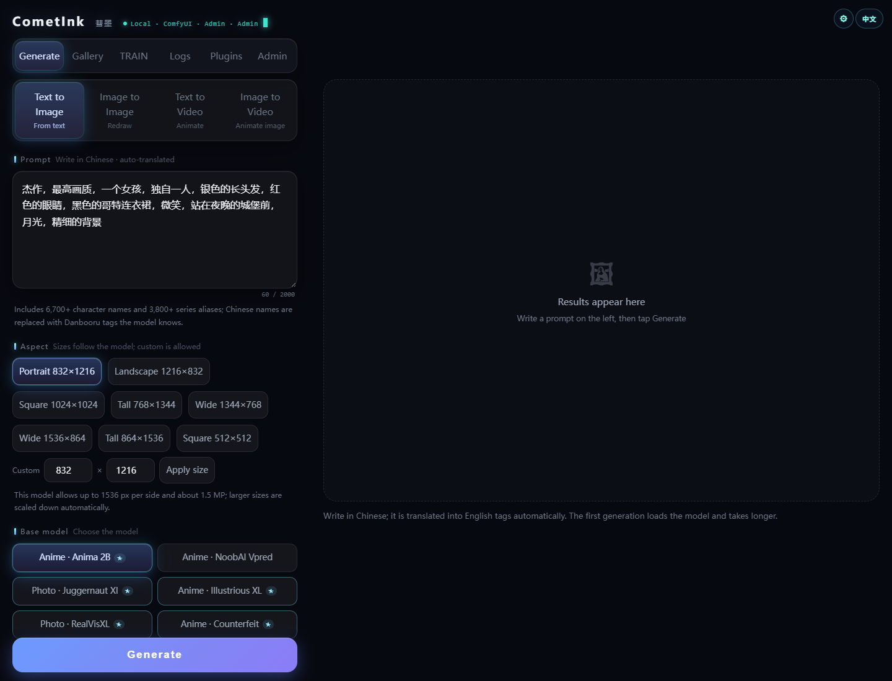
</p>
<p align="center"><sub>中文界面 · Chinese UI &nbsp;&nbsp;|&nbsp;&nbsp; English UI</sub></p>

### 图库 / Gallery

**中文** — 图库按账号和底模分目录，支持收藏、搜索、多选打包下载、放大和再次编辑。普通账号只能看到自己的图片，管理员可以按用户筛选。提示词正文、作品说明和用户自己起的名字属于用户内容，不会被界面翻译。

> **English** — The gallery is isolated by account and checkpoint, with favourites, search, multi-select ZIP export, upscale, and re-edit. Normal accounts see only their own images; the admin can filter by user. Prompt text, artwork captions, and user-chosen names are user content and are intentionally not translated.

<p align="center">
  
  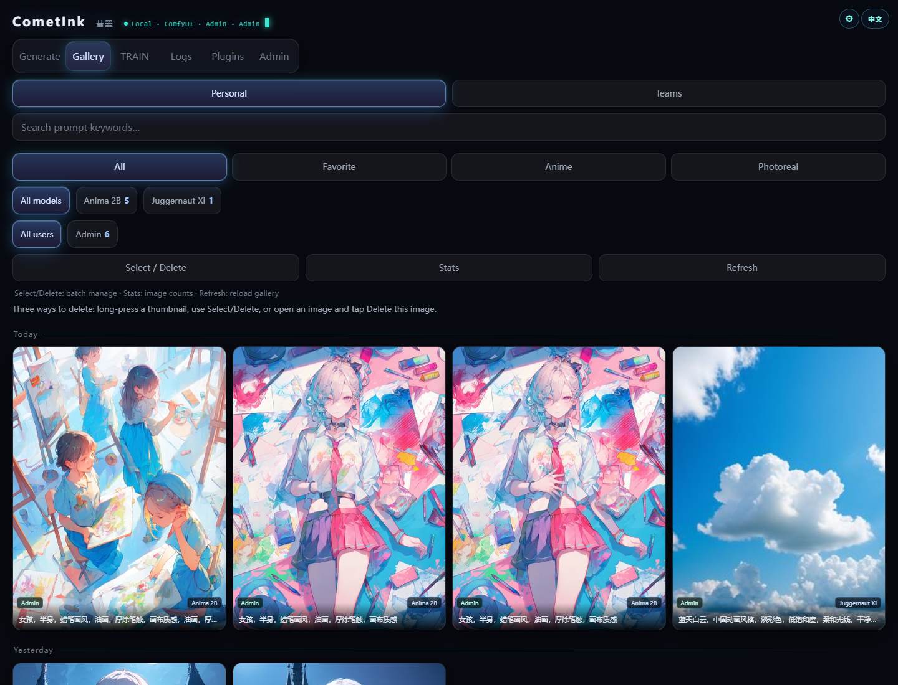
</p>
<p align="center"><sub>中文界面 · Chinese UI &nbsp;&nbsp;|&nbsp;&nbsp; English UI</sub></p>

### 插件中心 / Plugin centre

**中文** — 画风、提示词模板和参数预设可以打成 JSON 插件包直接导入，不执行代码；ComfyUI 代码插件先进入隔离区，做静态风险扫描，再由管理员审批安装。

> **English** — Styles, prompt templates, and parameter presets ship as safe JSON packs that never execute code. ComfyUI code plugins go into quarantine, get a static risk scan, and are installed only after admin approval.

<p align="center">
  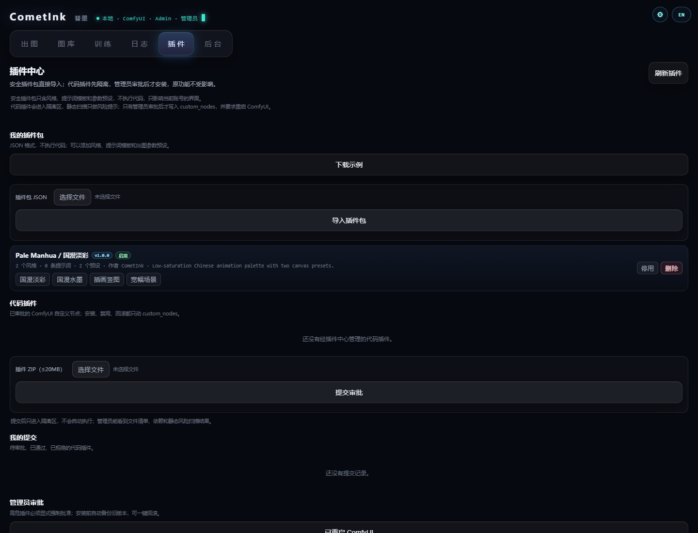
  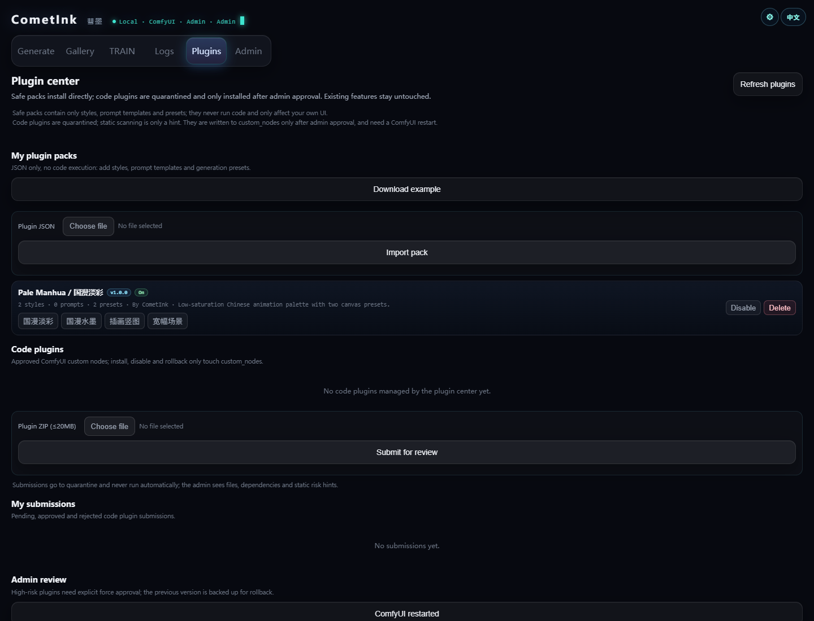
</p>
<p align="center"><sub>中文界面 · Chinese UI &nbsp;&nbsp;|&nbsp;&nbsp; English UI</sub></p>

### 手机与登录 / Mobile & sign-in

**中文** — 手机端自动换成单列布局，按钮和底部操作条会避让；登录页区分管理员和普通账号，连续输错 5 次会锁定 10 分钟。

> **English** — On phones the layout collapses to a single column with touch-sized controls. The sign-in page separates admin and normal accounts, and five failed attempts lock the IP for ten minutes.

<p align="center">
  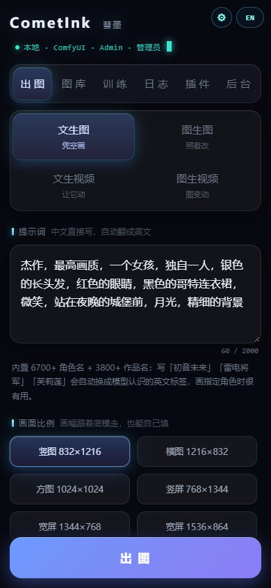
  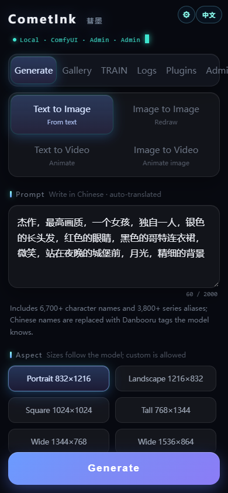
  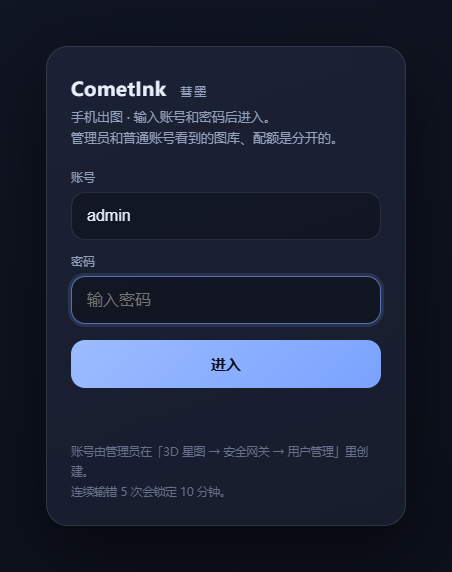
  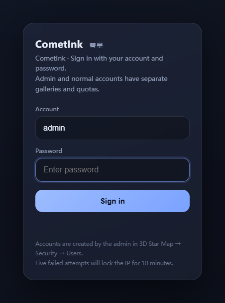
</p>
<p align="center"><sub>手机 · Mobile（中 / EN）&nbsp;&nbsp;|&nbsp;&nbsp; 登录 · Sign in（中 / EN）</sub></p>

### 页面切换 / Page tabs

**中文** — 桌面端可以一键切换出图 / 图库 / 训练 / 日志 / 插件 / 后台；下面两张 GIF 分别是中文和英文界面。

> **English** — Switch between Generate, Gallery, Train, Logs, Plugins, and Admin in one click. The two GIFs below show the Chinese and English interfaces.

<p align="center">
  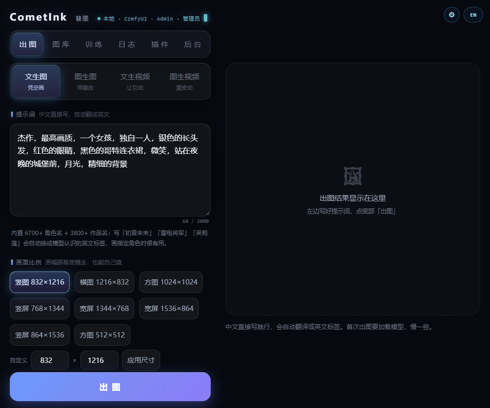
  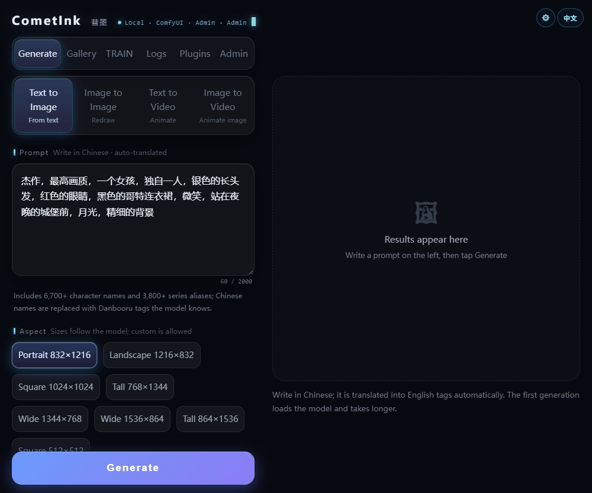
</p>
<p align="center"><sub>中文界面 · Chinese UI &nbsp;&nbsp;|&nbsp;&nbsp; English UI</sub></p>

---

## 管理员后台 / Admin console

**中文** — 管理员后台是彗墨和普通 ComfyUI 前端最不一样的地方：账号、限额、流量、队列、算力节点、模型、训练和日志都在这里。普通账号看不到「后台」标签，直接调用管理接口也会被拒绝。

> **English** — The admin console is where CometInk goes beyond a ComfyUI front end: accounts, quotas, traffic, queue, worker nodes, models, training, and logs all live here. Normal accounts do not see the Admin tab, and direct admin API calls are rejected.

### 概览与队列 / Overview & queue

**中文** — 一眼看到账号数、图片数、存储、今日/本月流量、GPU 秒和任务数；可以暂停新任务、设置最长等待、维护窗口和账号优先级，并逐台审批局域网算力节点。

> **English** — See accounts, images, storage, daily/monthly traffic, GPU seconds, and jobs at a glance. Pause new jobs, set a maximum wait, configure maintenance windows and per-account priority, and approve each LAN worker node.

<p align="center">
  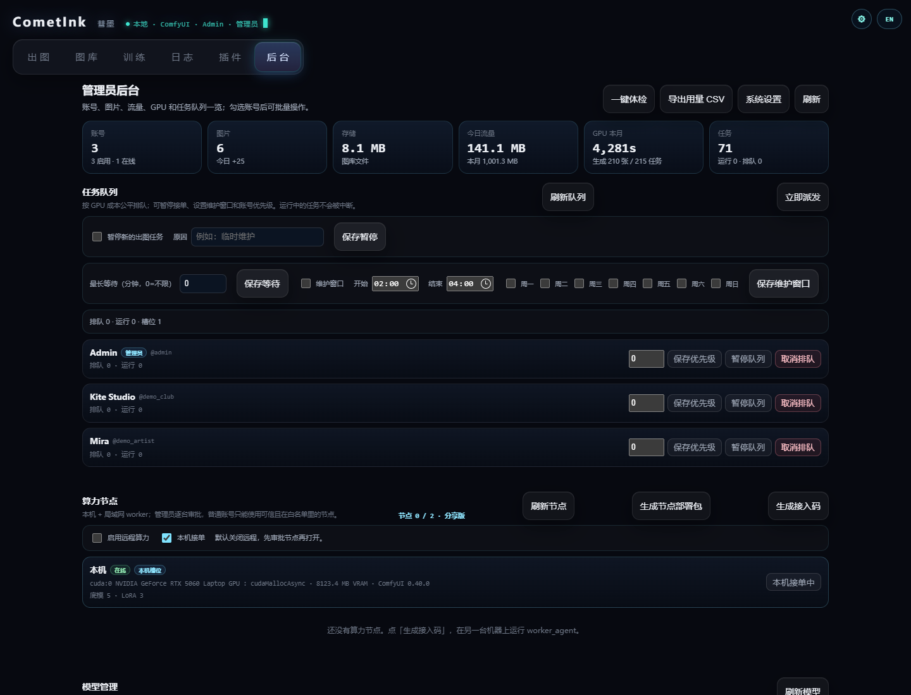
</p>
<p align="center"><sub>中文 · Chinese</sub></p>

<p align="center">
  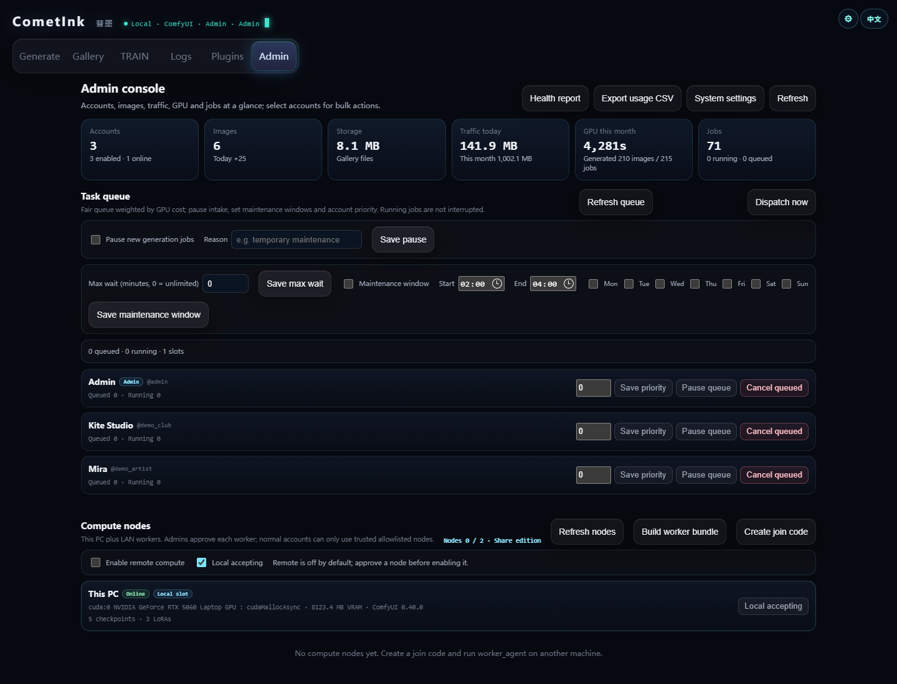
</p>
<p align="center"><sub>English</sub></p>

### 账号、限额与功能开关 / Accounts, limits & features

**中文** — 创建普通账号或 24 小时游客，搜索、勾选并批量启用/禁用/删除。每个账号可以单独设置每日张数、图库上限、存储、上传大小、像素、步数、单次张数、同时任务、每日/每月流量、GPU 秒和训练额度；14 个功能开关可以分别设为「不变 / 开启 / 关闭」。

> **English** — Create normal accounts or 24-hour guests, then search, select, and batch enable, disable, or delete. Per-account limits cover daily images, gallery size, storage, upload size, pixels, steps, images per run, concurrent jobs, daily/monthly traffic, GPU seconds, and training. Fourteen feature switches can be set to unchanged, on, or off.

<p align="center">
  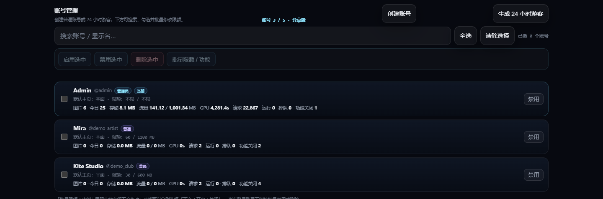
</p>
<p align="center"><sub>中文 · Chinese</sub></p>

<p align="center">
  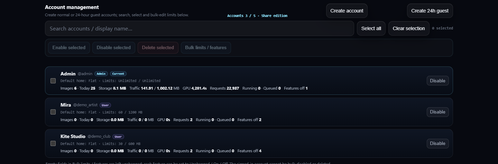
</p>
<p align="center"><sub>English</sub></p>

<p align="center">
  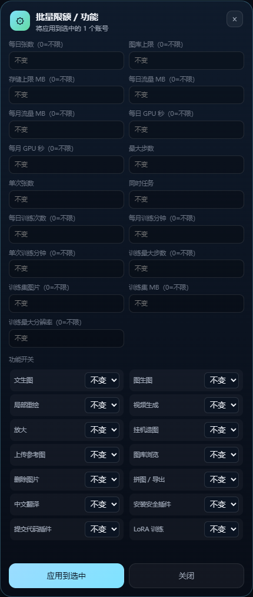
  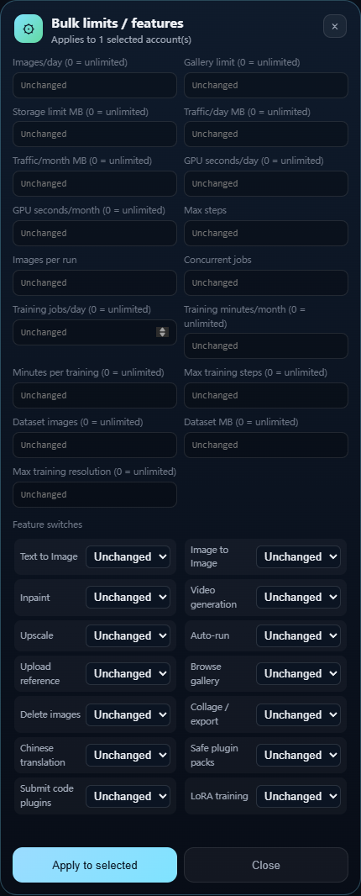
</p>
<p align="center"><sub>批量限额 / Bulk limits &nbsp;&nbsp;|&nbsp;&nbsp; 功能开关 / Feature switches</sub></p>

### 训练管理 / Training admin

**中文** — 管理员一键安装/修复训练组件，审核普通账号的 LoRA 训练申请，设置训练窗口、最大步数、数据集大小和显存阈值。训练期间本机出图自动让路，远程 worker 仍可接单。

> **English** — Install or repair the trainer, approve LoRA training requests, and set training windows, step limits, dataset limits, and VRAM thresholds. Local generation yields the GPU while training runs; remote workers can keep serving.

<p align="center">
  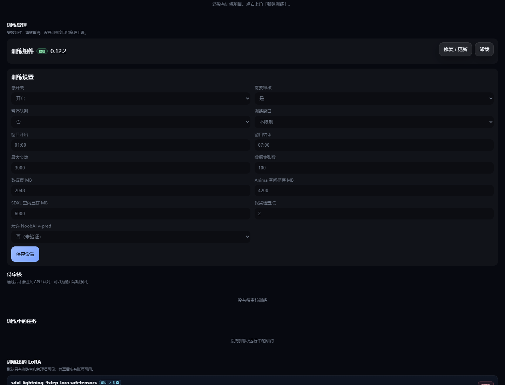
</p>
<p align="center"><sub>中文 · Chinese</sub></p>

<p align="center">
  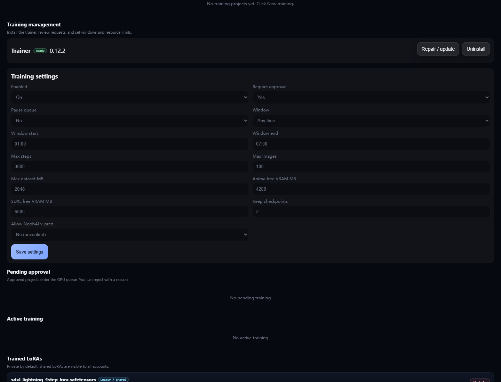
</p>
<p align="center"><sub>English</sub></p>

### 日志审计 / Audit logs

**中文** — 用户活动记录登录、出图、图库操作、挂机、放大；安全日志记录登录失败、权限拦截、账号管理和超限拒绝。支持按用户、动作、模型和 IP 搜索，默认保留 30 天。

> **English** — Activity logs cover sign-ins, generation, gallery actions, auto-run, and upscale. Security logs cover failed sign-ins, permission blocks, account changes, and quota rejections. Search by user, action, model, or IP; logs are kept for 30 days by default.

<p align="center">
  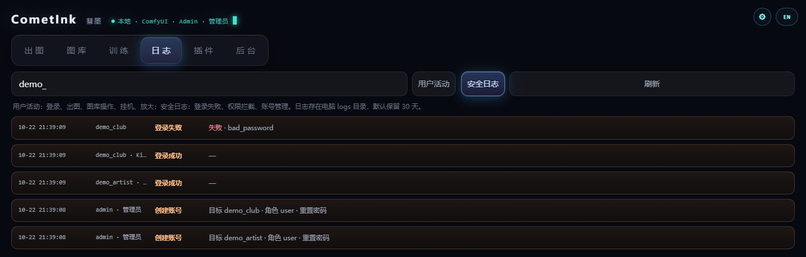
</p>
<p align="center"><sub>中文 · Chinese</sub></p>

<p align="center">
  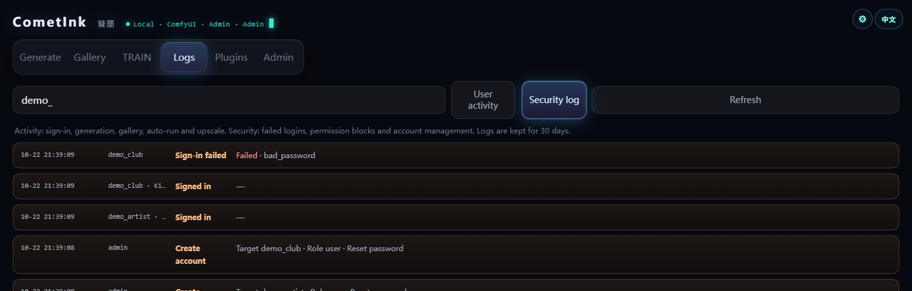
</p>
<p align="center"><sub>English</sub></p>

### 模型管理 / Model management

**中文** — 查看已装模型及其分类、大小和日期；支持浏览器分块上传、从服务器路径导入，删除先进回收站，7 天内可恢复。正在被任务或训练使用的模型不能删除。

> **English** — Inspect installed models by category, size, and date. Upload from the browser, import from a server path, and delete to a seven-day recycle bin. Models used by a running job or training cannot be deleted.

<p align="center">
  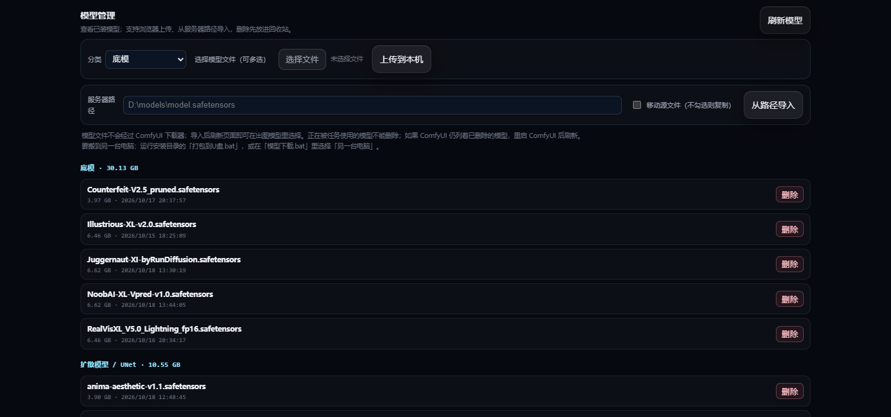
  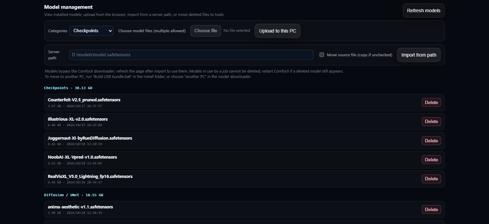
</p>
<p align="center"><sub>中文界面 · Chinese UI &nbsp;&nbsp;|&nbsp;&nbsp; English UI</sub></p>

---

## 3D 接口星图 / 3D API star map

**中文** — 桌面端按 `更多 ▾ → 打开 3D 接口星图` 进入 `/universe`。星球代表功能、分类和接口，连线代表调用关系；任务运行时会点亮对应节点。可以拖拽旋转、滚轮/双指缩放、点星球看详情、双击直接进入功能，按「流程」只看 16 步主链和 B1~B5 支线。

> **English** — Open `/universe` from `More ▾ → Open 3D API star map`. Planets represent features, categories, and APIs; links represent call relationships, and running jobs light up the relevant nodes. Drag to rotate, wheel/pinch to zoom, click for details, double-click to open a feature, or switch to Flow to see the 16-step main chain and B1–B5 branches.

<p align="center">
  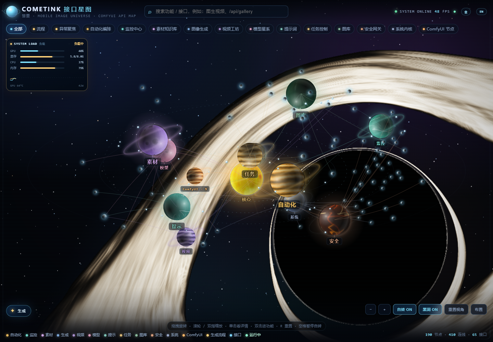
</p>
<p align="center"><sub>中文 · Chinese</sub></p>

<p align="center">
  
</p>
<p align="center"><sub>English</sub></p>

<p align="center">
  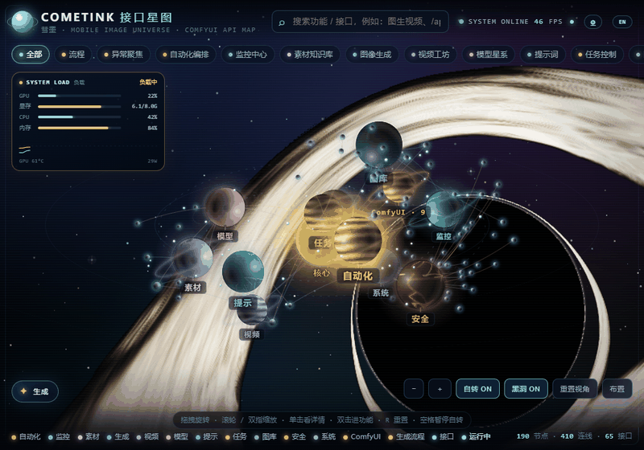
  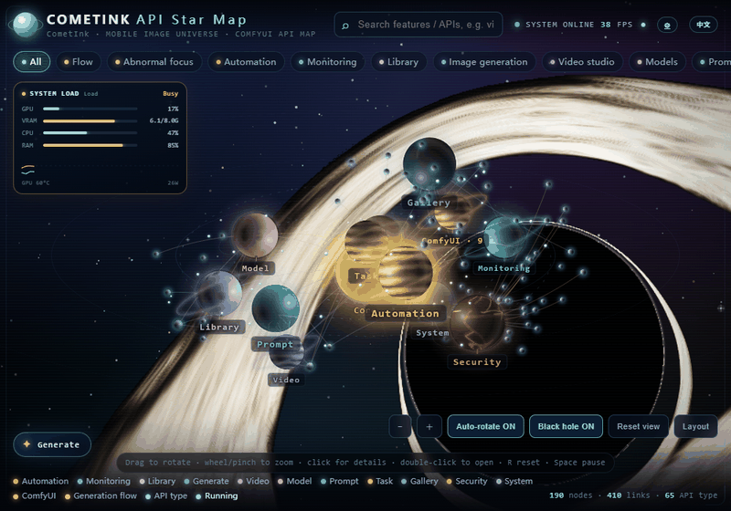
</p>
<p align="center"><sub>星图旋转与交互 / Star map rotation & interaction（中 / EN）</sub></p>

星图里还可以：打开生成舱直接出图、查看任务队列和系统负载、按 `P` 进入布置模式拖动星球并保存布局、按 `B` 开关黑洞背景。  
The star map also includes an in-map generation deck, queue and system-load panels, a layout mode (`P`) for dragging and saving planet positions, and a black-hole background toggle (`B`).

---

## 核心能力 / Core capabilities

| 模块 / Module | 中文 | English |
|---|---|---|
| 出图 / Generation | Anima 2B、NoobAI Vpred、Illustrious、Juggernaut XI、RealVisXL、Counterfeit；文生图、图生图、局部重绘、高清修复、2×/4× 放大；Wan 2.1 文生视频 / VACE 图生视频；中文翻译、角色词典、画风、PAG、Anima Turbo 8 步。 | Anima 2B, NoobAI Vpred, Illustrious, Juggernaut XI, RealVisXL, Counterfeit; text-to-image, image-to-image, inpaint, hires fix, 2×/4× upscale; Wan 2.1 text-to-video and VACE image-to-video; Chinese translation, character dictionary, styles, PAG, and Anima Turbo at 8 steps. |
| 多人与队列 / Users & queue | 管理员 / 普通账号 / 24 小时游客；每日限额、流量、GPU 秒、功能开关、可用底模白名单；按 GPU 成本加权、最久未服务优先的公平队列；全局/单账号暂停、维护窗口、优先级加成；远程 worker 准入校验节点、ComfyUI 版本和模型大小。 | Admin, normal, and 24-hour guest accounts; daily quotas, traffic, GPU seconds, feature switches, and model allow-lists; a GPU-cost-weighted least-recently-served fair queue; global/per-user pause, maintenance windows, and priority boosts; worker admission checks for nodes, ComfyUI version, and model sizes. |
| 图库与训练 / Gallery & training | 账号隔离 + 按模型分目录；收藏、搜索、多选 ZIP、放大、再次编辑；LoRA 训练支持管理员审核、数据集上传/图库导入、资源闸门、私有/共享 LoRA。 | Account isolation plus per-model folders; favourites, search, multi-select ZIP, upscale, and re-edit. LoRA training includes admin approval, dataset upload/gallery import, resource gates, and private/shared LoRA. |
| 管理员与安全 / Admin & security | 管理员后台、活动/安全日志、HTTPS、PBKDF2 密码、会话 token 哈希、登录锁定、设备管理、上传隔离区、Pillow 真解码、路径穿越防护、HTML 转义、备份/恢复/还原点、监控与体检。 | Admin console, activity/security logs, HTTPS, PBKDF2 passwords, hashed session tokens, login lockout, device management, upload quarantine, real Pillow decoding, path-traversal protection, HTML escaping, backup/restore/restore points, monitoring, and health reports. |

---

## 架构 / Architecture

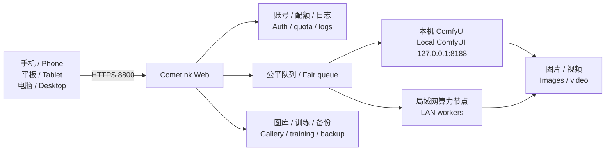

- `comfy_client.py`：唯一的 ComfyUI 访问层（地址、接口、节点能力检查）  
  The single ComfyUI access layer (URL, endpoints, node capability checks)
- `comfy_workflows.py` + `workflow_templates.json`：工作流构建与模板  
  Workflow construction and templates
- `model_catalog.json`：模型家族、尺寸和预设  
  Model families, sizes, and presets
- `app_core.py`：账号、图库、队列、日志、训练、监控  
  Accounts, gallery, queue, logs, training, monitoring
- `web_server.py`：HTTP/HTTPS 路由与启动  
  HTTP/HTTPS routing and startup

---

## 快速开始 / Quick start

1. **下载 / Download** — 从 **Releases** 下载 `CometInk-v1.3.6-Share.zip`。  
   Download `CometInk-v1.3.6-Share.zip` from **Releases**.
2. **安装 / Install** — 解压到普通目录，双击 `安装.bat`（英文入口 `install.bat`）。  
   Extract to a normal folder and run `安装.bat` (English entry: `install.bat`).
3. **选择 / Choose** — 阅读免责声明，设置管理员密码，选择模型包。  
   Read the disclaimer, set the admin password, and choose a model pack.
4. **启动 / Launch** — 双击桌面的 **CometInk Studio**。  
   Double-click **CometInk Studio** on the desktop.
5. **电脑 / Desktop** — 打开 `https://127.0.0.1:8800/`，用 `admin` 登录。  
   Open `https://127.0.0.1:8800/` and sign in as `admin`.
6. **手机 / Phone** — 连电脑热点，打开 `https://192.168.137.1:8800`。  
   Join the PC hotspot and open `https://192.168.137.1:8800`.

完整步骤、界面说明、故障排查见 **[MANUAL.md](MANUAL.md)**。  
Full steps, UI reference, and troubleshooting are in **[MANUAL.md](MANUAL.md)**.

> 安装器界面是中文；英文用户可以看 **[INSTALL.en.md](INSTALL.en.md)**，里面有中文提示对照和无交互安装命令。  
> The installer UI is in Chinese; English users can follow **[INSTALL.en.md](INSTALL.en.md)** for a prompt label map and an unattended install command.

### 详细文档 / Documentation

- [MANUAL.md](MANUAL.md) — 完整使用手册 / Full manual
- [INSTALL.en.md](INSTALL.en.md) — 英文安装与使用指南 / English installation & usage guide
- [安装说明.txt](安装说明.txt) — 安装器逐步说明 / Installer walkthrough
- [EDITIONS.md](EDITIONS.md) — 分享版 / 商用版构建说明 / Share & Commercial builds
- [VERSION_LOCK.md](VERSION_LOCK.md) — ComfyUI / 依赖 / 模型版本锁定 / Version lock
- [CHANGELOG.md](CHANGELOG.md) — 版本变更 / Changelog

---

## 分享版与商用版 / Share & Commercial

| 项目 / Item | 分享版 / Share | 商用版 / Commercial |
|---|---|---|
| 许可证 / License | PolyForm Noncommercial 1.0.0 | 商业 EULA / Commercial EULA |
| 默认安装 / Installer | 完整安装器，可选模型/插件 / Full installer with optional models/plugins | 商业清洁模式 / Commercial clean mode |
| 账号上限 / Accounts | 5 | 50 |
| 远程节点 / Workers | 2 | 20 |
| 激活 / Activation | 不需要 / Not required | 机器码 + 离线授权码 / Machine ID + offline licence |

分享版可用于个人学习、研究、实验、爱好和非商业组织；商业用途需另购商用授权。  
The Share edition is for personal study, research, experimentation, hobbies, and non-commercial organisations. Commercial use requires a Commercial licence.

---

## 安全边界 / Security boundary

**只为局域网 / Windows 热点内网设计。**  
**Designed for LAN / Windows hotspot use only.**

- 服务只监听 `127.0.0.1` 和热点地址 `192.168.137.1`，不监听 `0.0.0.0`。  
  The service binds only `127.0.0.1` and the hotspot address `192.168.137.1`, never `0.0.0.0`.
- 不要把 8800 / 8188 映射到公网，不要使用内网穿透、反向代理、VPN 或公网 IPv6 暴露。  
  Do not map 8800/8188 to the public internet, and do not expose them through tunnels, reverse proxies, VPNs, or public IPv6.
- 自签 HTTPS 证书首次打开会有浏览器警告，点「高级 → 继续前往」即可。  
  The self-signed HTTPS certificate triggers a browser warning on first use; choose “Advanced → Proceed”.
- 详细条款见 [DISCLAIMER.md](DISCLAIMER.md)。  
  See [DISCLAIMER.md](DISCLAIMER.md) for the full terms.

---

## 测试 / Tests

当前版本完整测试套件 **231 项通过**（5 项在线 HTTP 测试按环境跳过）。  
The current suite passes **231 tests** (5 online HTTP tests are skipped depending on the environment):

```powershell
python tests\run_tests.py
```

测试覆盖安装器布局、账号权限、队列、图库隔离、模型目录、工作流模板、节点机准入、上传校验、备份恢复、星图布局和加密会话等。  
Coverage includes installer layout, account permissions, queueing, gallery isolation, model folders, workflow templates, worker admission, upload validation, backup/restore, star-map layout, and encrypted sessions.

---

## License

- 分享版 / Share edition：**PolyForm Noncommercial License 1.0.0**
- 商用版 / Commercial edition：见 [COMMERCIAL_LICENSE.md](COMMERCIAL_LICENSE.md) / 商业 EULA
- 第三方组件与模型许可 / Third-party notices：[THIRD_PARTY_NOTICES.md](THIRD_PARTY_NOTICES.md)

<p align="center">
  <sub>CometInk 彗墨 · 本地、私有、手机优先的 ComfyUI 工作台<br>
  Local, private, mobile-first ComfyUI studio</sub>
</p>


---

## 开发说明 / Development note

CometInk 由一名大一学生单人从零完成：需求、架构、后端、前端、星图、测试、文档和发布流程均由一人推进，开发期间使用 AI 编程助手辅助。近 30 天累计 **6,038,125,446 tokens**（约 60.4 亿）、**17,517 次 API 请求**，API 费用 **¥227.20**；当前版本通过 **231 项测试**，并经过人工审查。

CometInk was built solo from scratch by a first-year university student: requirements, architecture, backend, frontend, star map, tests, documentation, and releases were all driven by one developer, with AI coding assistants. In the last 30 days: **6,038,125,446 tokens**, **17,517 API requests**, and **¥227.20** in API usage. The current build passes **231 tests** and has been manually reviewed.

---

## 赞赏 / Support

如果这个项目帮到了你，可以请我喝杯奶茶。赞赏完全自愿，不影响任何功能。
If CometInk saved you some time, you can buy me a coffee. Tips are optional and never affect any feature.

<p align="center">
  
</p>
<p align="center"><sub>微信赞赏码 · WeChat tip code</sub></p>
