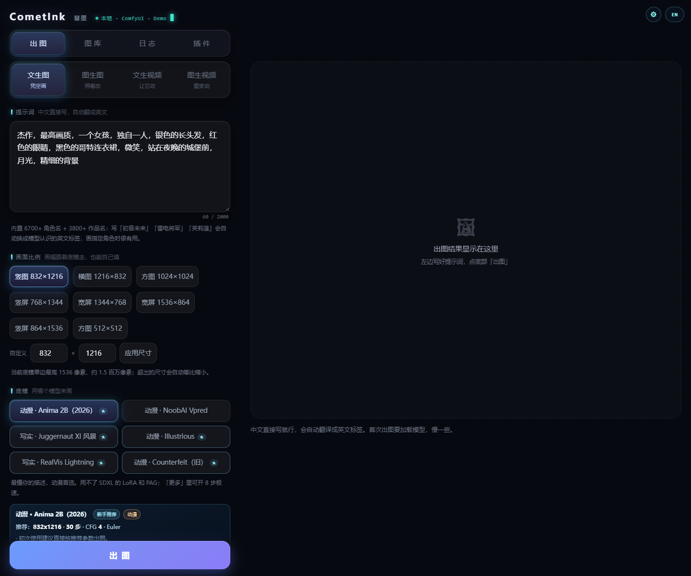
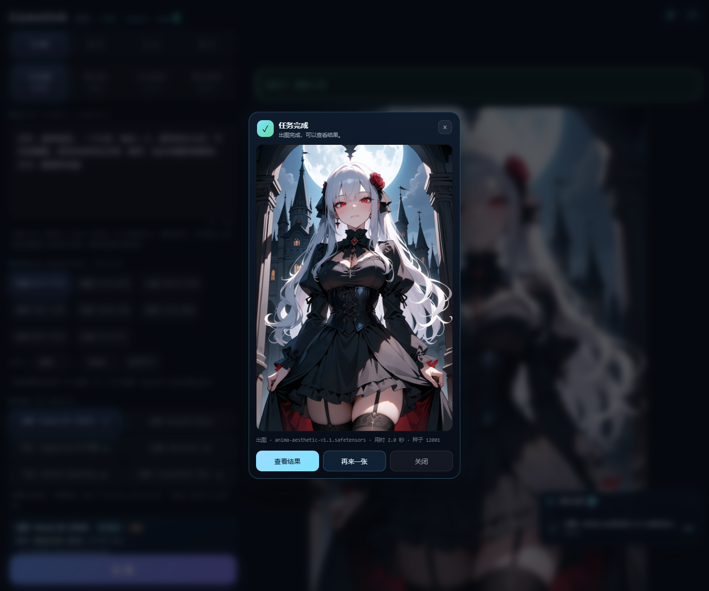
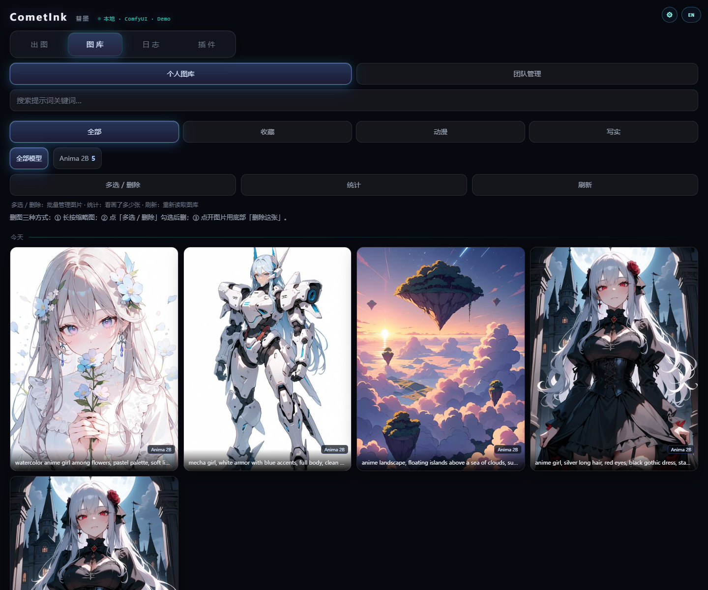
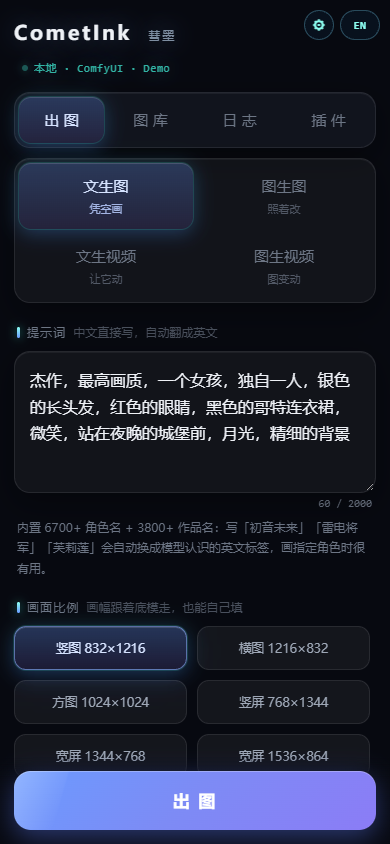
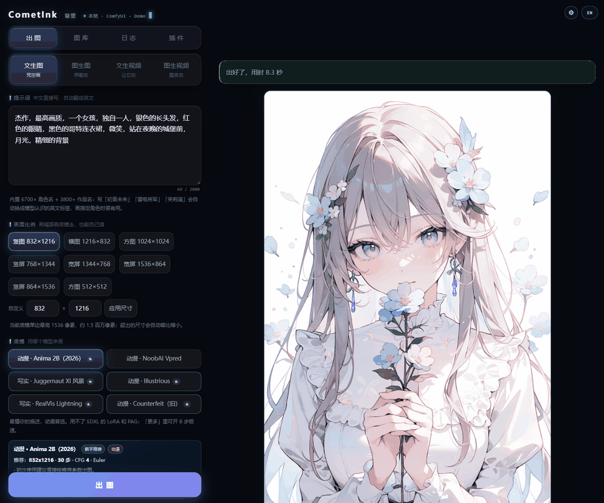
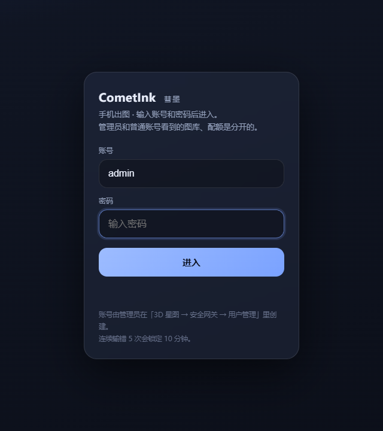
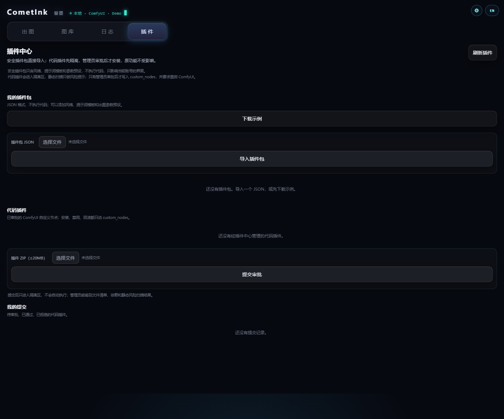
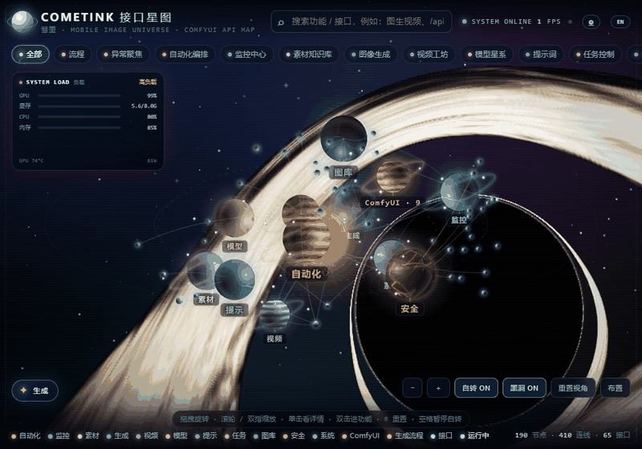
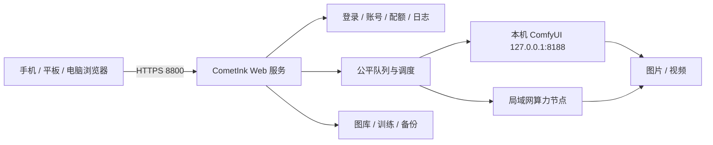

<p align="center">
  
</p>

<p align="center">
  <b>把 ComfyUI 变成一台可以用手机浏览器操作的本地出图工作站。</b><br>
  手机出图 · 多人排队 · 图库隔离 · LoRA 训练 · 3D 接口星图
</p>

<p align="center">
  
  
  
  
  
</p>

> **CometInk** is a local, mobile-first control room for ComfyUI.  
> It turns a single Windows GPU machine into a small, private image-generation
> studio: phone-friendly UI, fair multi-user queue, isolated galleries,
> optional LoRA training, and a 3D map of every feature and API.

---

## 为什么是彗墨

| 手机上真的能用 | 多人共用不打架 | 数据留在本机 |
|---|---|---|
| 不用装 App。手机连上电脑热点，打开网页就能写提示词、看图库、排队和取消任务；也可以添加到主屏幕当 PWA。 | 多账号、每日限额、功能开关、流量统计、活动/安全日志；按“最久未服务优先”公平排队，不会一个人把显卡塞满。 | 图片、账号、日志和训练数据默认都在本机。没有开发者服务器，不需要注册云账号。 |

它不是另一个 ComfyUI 皮肤，而是把“出图这件事”补上日常使用需要的那一层：

- **输入**：中文提示词、角色词典、画风、负面提示、LoRA、画幅、种子
- **执行**：本机 ComfyUI + 局域网 worker，统一队列、进度和取消
- **输出**：账号/模型隔离的图库、收藏、打包下载、放大、再次编辑
- **管理**：账号、配额、流量、日志、备份、还原点、监控和体检

---

## 界面

### 出图工作台

左栏写提示词、选模式/画幅/底模/画风，右栏实时显示进度和结果。
中文可以直接写，系统会自动翻成英文；也可以点「看译文」检查模型实际收到的内容。

<p align="center">
  
</p>

### 结果与图库

生成完成后弹出结果卡片，可以直接查看、再来一张或关闭。
图库按账号和底模分目录，支持收藏、筛选、多选打包下载、放大和再次编辑。

<p align="center">
  
  
</p>

### 手机与页面切换

手机端自动换成单列布局，按钮和底部操作条会避让；桌面端可以一键切换出图 / 图库 / 日志 / 插件。

<p align="center">
  
  
</p>

> 截图中的作品由 CometInk 调用 Anima 2B 生成，仅用于界面展示。

### 登录与插件中心

账号由管理员在星图里创建，普通账号只看到自己的图库、任务和额度。
插件中心把画风 / 提示词 / 预设包与 ComfyUI 代码插件分开管理：
JSON 包直接导入，代码插件先进入隔离区、做静态风险扫描，再由管理员审批。

<p align="center">
  
  
</p>

---

## 3D 接口星图

桌面端按 `更多 ▾ → 打开 3D 接口星图` 进入 `/universe`。  
星球代表功能、分类和接口，连线代表调用关系；任务运行时会点亮对应节点。

<p align="center">
  
</p>

<p align="center">
  
</p>

星图里可以：

- 拖拽旋转、滚轮/双指缩放，点星球看详情，双击直接进入对应功能
- 用「流程」过滤只看 16 步主链和 B1~B5 支线
- 看实时任务、队列、接口调用和系统负载
- 打开生成舱，不离开星图就能写提示词、出图、看进度
- 按 `P` 进入布置模式，拖动星球保存自己的布局
- 按 `B` 开关黑洞背景

---

## 核心能力

### 出图

- Anima 2B / NoobAI Vpred / Illustrious / Juggernaut XI / RealVisXL / Counterfeit
- 文生图、图生图、局部重绘、高清修复、2×/4× 放大
- Wan 2.1 文生视频 / VACE 图生视频（480p，1~3 秒）
- 中文提示词翻译、角色词典、画风快捷后缀、PAG 画质增强
- Anima 极速模式：官方 Turbo LoRA，8 步出图

### 多人与队列

- 管理员 / 普通账号 / 24 小时游客
- 每日图片数、图库总数、存储、上传大小、最大像素、步数、张数、同时任务
- 每日/每月流量额度、GPU 秒统计、功能开关、可用底模白名单
- 最久未服务优先的公平队列；全局/单账号暂停、维护窗口、优先级加成
- 远程 worker 接入前校验节点、ComfyUI 版本和模型大小

### 图库与训练

- 账号隔离 + 按模型分目录；收藏、搜索、多选 ZIP、放大、再次编辑
- LoRA 训练：管理员审核、数据集上传/图库导入、资源闸门、私有/共享 LoRA
- 训练期间本机出图自动让路，远程 worker 仍可接单

### 安全与运维

- HTTPS 自签证书，只监听本机和热点地址
- PBKDF2-SHA256 密码、会话 token 哈希、登录锁定、设备管理
- 上传隔离区、Pillow 真解码、路径穿越防护、HTML 转义
- 活动/安全日志、用量 CSV/JSON、一键体检、备份/恢复/还原点
- 监控中心：健康评分、告警、任务时间线、趋势、容量预测、Prometheus

---

## 架构



- `comfy_client.py`：唯一的 ComfyUI 访问层（地址、接口、节点能力检查）
- `comfy_workflows.py` + `workflow_templates.json`：工作流构建与模板
- `model_catalog.json`：模型家族、尺寸和预设
- `app_core.py`：账号、图库、队列、日志、训练、监控
- `web_server.py`：HTTP/HTTPS 路由与启动

---

## 快速开始

1. 从 **Releases** 下载 `CometInk-v1.3.5-Share.zip`；
2. 解压到普通目录，双击 `安装.bat`；
3. 阅读免责声明，设置管理员密码，选择模型包；
4. 安装完成后双击桌面的 **CometInk Studio**；
5. 浏览器打开 `https://127.0.0.1:8800/`，用 `admin` 登录；
6. 手机连电脑热点，打开 `https://192.168.137.1:8800`。

完整步骤、界面说明、故障排查见 **[MANUAL.md](MANUAL.md)**。

### 详细文档

- [MANUAL.md](MANUAL.md) — 完整使用手册
- [安装说明.txt](安装说明.txt) — 安装器逐步说明
- [EDITIONS.md](EDITIONS.md) — 分享版 / 商用版构建说明
- [VERSION_LOCK.md](VERSION_LOCK.md) — ComfyUI / 依赖 / 模型版本锁定
- [CHANGELOG.md](CHANGELOG.md) — 版本变更

---

## 分享版与商用版

| 项目 | 分享版 | 商用版 |
|---|---|---|
| 许可证 | PolyForm Noncommercial 1.0.0 | 商业 EULA |
| 默认安装 | 完整安装器，可选模型/插件 | 商业清洁模式 |
| 账号上限 | 5 | 50 |
| 远程节点上限 | 2 | 20 |
| 激活 | 不需要 | 机器码 + 离线授权码 |

分享版可用于个人学习、研究、实验、爱好和非商业组织；商业用途需另购商用授权。

---

## 安全边界

**只为局域网 / Windows 热点内网设计。**

- 服务只监听 `127.0.0.1` 和热点地址 `192.168.137.1`，不监听 `0.0.0.0`
- 不要把 8800 / 8188 映射到公网，不要使用内网穿透、反向代理、VPN 或公网 IPv6 暴露
- 自签 HTTPS 证书首次打开会有浏览器警告，点「高级 → 继续前往」即可
- 详细条款见 [DISCLAIMER.md](DISCLAIMER.md)

---

## 测试

当前版本完整测试套件 **231 项通过**（5 项在线 HTTP 测试按环境跳过）：

```powershell
python tests\run_tests.py
```

测试覆盖安装器布局、账号权限、队列、图库隔离、模型目录、工作流模板、
节点机准入、上传校验、备份恢复、星图布局和加密会话等。

---

## License

- 分享版：**PolyForm Noncommercial License 1.0.0**
- 商用版：见 [COMMERCIAL_LICENSE.md](COMMERCIAL_LICENSE.md) / 商业 EULA
- 第三方组件与模型许可见 [THIRD_PARTY_NOTICES.md](THIRD_PARTY_NOTICES.md)

<p align="center">
  <sub>CometInk 彗墨 · 本地、私有、手机优先的 ComfyUI 工作台</sub>
</p>
