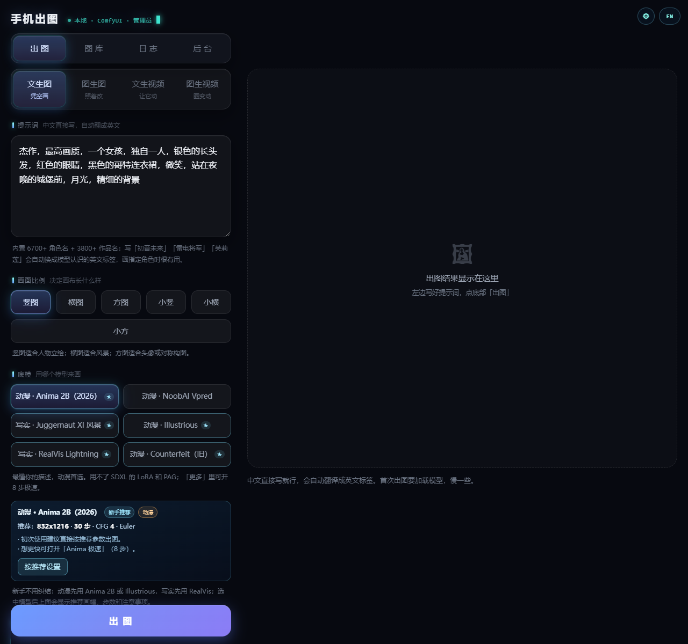
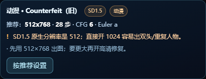
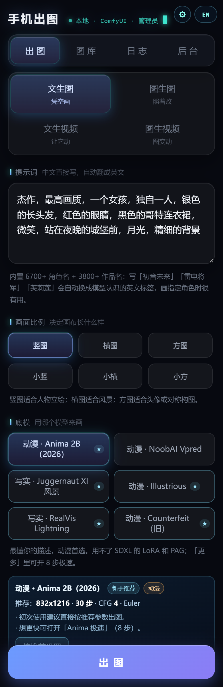

# ComfyUI Mobile Studio · 手机出图

把 ComfyUI 包装成一个可以用手机浏览器访问的出图工作台：

- 手机扫码/打开网页即可出图，支持文生图、图生图、局部重绘、高清修复、放大
- 多账号、管理员/普通账号、每日限额、功能开关、流量统计、活动日志、安全日志
- 按 GPU 成本加权公平排队：分类 ETA、开始/完成时间范围、最长等待、全局/单账号暂停、
  优先级加成和维护窗口
- 每日/每月 GPU 秒配额，按预计耗时预检查，任务完成后记入用量统计
- 团队 / 项目：成员角色（所有者/编辑者/只读）、团队图库聚合视图、共享提示词库
- 登录设备管理：查看 IP/浏览器/最后活跃时间，退出指定设备或其他设备
- 用量 CSV / JSON 导出；任务开始/完成/失败 Webhook 通知（不含提示词和图片）
- 可选企业反向代理用户名头认证（只信任本机回环代理）
- 自助修改密码、浏览器出图完成通知、一键备份/恢复
- 账号间图片隔离，按底模分目录；图库支持多选打包下载
- 输入防护：提示词/负面提示 2000 字上限、实时字数、清理控制/零宽/双向字符
- 异常恢复：排队任务重启后自动重排；未提交任务安全重试；已提交任务不重复出图
- 守护进程：ComfyUI / 网页服务异常退出自动重启，指数退避、每小时上限可设置
- 可信时间：在线 NTP/HTTPS 校时，离线单调计时，检测系统时间回拨
- 额度用完时弹窗说明已用/上限/重置时间，并提供清理入口
- 3D 星图连线与星球有真实前后遮挡：连线可显示在星球前方或被星球挡住
- 自动磁盘清理（默认关闭）：只清超过保留天数且未收藏的旧文件，图库会给用户提示
- 模型管理：浏览器分块上传、服务器路径导入、删除到回收站（7 天内可恢复）
- LoRA 训练：管理员审核、Anima 2B 推荐、数据集上传/图库导入、训练期间本机出图
  自动让路、LoRA 私有/共享管理；训练组件按需一键安装到隔离目录
- 自定义节点导入：ZIP 分块上传 / 服务器路径，检查 `__init__.py`、
  `NODE_CLASS_MAPPINGS`、Python 语法、requirements 依赖和 ZIP 安全
- 工作流库：导入 UI / API 格式 JSON，体检缺失节点、缺失模型、断链和循环依赖
- 插件中心：安全 JSON 插件包（画风/提示词/预设，不执行代码）可直接导入；
  ComfyUI 代码插件先隔离、静态风险扫描、管理员审批，支持备份/禁用/回滚
- 商用版机器码绑定与离线授权码激活；一键体检生成 HTML/JSON/日志 ZIP 报告
- 分享版 / 商用版额度不同：启用账号 5 / 50，算力节点 2 / 20（本地强制校验）
- 模型下载前可选择本机或另一台电脑；一键打包到 U 盘并一键迁移到新机器
- 多台机器算力共享：中央统一排队，把任务派给局域网内的 worker
- 中文提示词自动翻译成英文，角色词典辅助
- 可接入 Ollama / OpenAI 兼容的本地小模型翻译，用户可在个人设置里自由选择
- 24 小时游客账号：管理员一键生成，到期自动禁用并踢下线
- 配置还原点、一键回滚和系统重置（保留当前管理员和图片）
- 自动识别 Anima / SDXL / Pony / v-pred / SD1.5 等模型家族，推荐参数并提醒风险
- 新手引导：★ 推荐模型、推荐画幅/步数、一键「按推荐设置」
- 模型自适应画幅：每个底模列出擅长尺寸，也支持自定义宽高（16px 对齐，
  超限自动等比缩小）；视频 6 档画幅、0.5~4 秒，可手填 0.5~6 秒
- 自带 3D 接口星图（桌面端）、中英文界面、实时任务进度；总览自动低细节，
  按需渲染贴图/流光，桌面约 40+ FPS；黑洞背景可一键隐藏（B）
- 监控中心：健康评分、告警中心、一键诊断、任务时间线、趋势、容量预测、
  节点遥测、异常聚焦、Webhook 和 Prometheus 指标
- 一键安装器：检测环境、下载 ComfyUI、安装依赖、下载模型、生成证书

**本仓库不包含模型文件，也不包含 ComfyUI 本体和 Python 运行库。**
安装器会联网下载这些内容；模型来自原作者的 Hugging Face 仓库。

安装器默认使用 `installer/versions.lock.json`：ComfyUI、Python 依赖、自定义节点
commit、模型 revision 和 7zr 哈希都已锁定，不会自动追最新版本。详见
`VERSION_LOCK.md`。

## 两个版本

| 版本 | 授权 | 默认行为 | 发布包 |
|---|---|---|---|
| **分享版** | PolyForm Noncommercial 1.0.0 | 完整安装器，用户可选择 ComfyUI/模型/插件/翻译 | `*-Share.zip` |
| **商用版** | 商业 EULA，需书面授权 | 只装安装器和网页代码，默认商业清洁模式 | `*-Commercial.zip` |

分享版非商业免费、源码可见，但**不是 OSI 开源许可证**；商业经营需购买商用授权。
详见 `EDITIONS.md`、`COMMERCIAL_LICENSE.md`、`商用授权说明.md`。

### 商用版激活（机器码 + 离线授权码）

商用版安装后第一次打开会跳到 `/license`，页面显示本机 **机器码**：

1. 把机器码发给供应商；
2. 供应商用私钥签发授权码（签发工具只留在维护者本地，不进入公开仓库）；
3. 在激活页粘贴授权码或导入 JSON 文件，立即生效；
4. 授权码绑定机器码，可设置到期时间；复制到其他机器会提示「不属于这台机器」。

授权状态可以在「后台 → 系统设置 → 商用授权」查看；到期前用新码覆盖激活即可续期。
`license.json` 只保存授权码，不包含私钥。**签发私钥不在仓库和任何发布包中。**

> 离线授权无法从技术上阻止直接修改客户端代码的破解；它的作用是明确授权边界、
> 防止授权码在客户机器之间复制，并保护私钥不进入客户环境。

## 界面预览







---

## 1. 安装前准备

| 项目 | 要求 |
|---|---|
| 系统 | Windows 10 / 11 64 位 |
| 显卡 | NVIDIA，建议 8GB 显存以上；RTX 50 系可用 cu128 包 |
| 磁盘 | 至少 20GB 空闲；默认安装约 14GB；全部模型包约 66GB |
| 网络 | 能访问 `gh-proxy.com`、`hf-mirror.com`、`argos-net.com` |
| 手机 | 和电脑连同一个 Windows 移动热点（默认 `192.168.137.x`） |

安装器会自动检测系统版本、显卡、磁盘空间和下载源。

> 没有 NVIDIA 显卡也能装，但 CPU 出图会非常慢，不建议。

## 2. 安装

1. 分享版从 GitHub Releases 下载 `ComfyUI-Mobile-Studio-v1.2.0-Share.zip`；
   商用客户使用 `ComfyUI-Mobile-Studio-v1.2.0-Commercial.zip`。
2. 解压到一个目录（不要在压缩包里直接运行）。
3. 双击 `安装.bat`（或 `install.bat`）。
4. 按提示操作：

   - 选择安装目录，默认 `D:\AI\ComfyUI_windows_portable`
   - 设置管理员密码（至少 8 位）
   - 选择模型包：直接回车 = Anima 2B + 放大模型
   - 等待下载 ComfyUI、Python 依赖、自定义节点和模型

5. 安装完成后，桌面会出现 **手机出图** 快捷方式。

安装器会做这些事：

- 下载并解压锁定版 ComfyUI v0.42.0 便携包（自带 Python，无需另装 Python）
- 默认不再拉取 master；需要显式升级时才使用 `-AllowUpdates`
- 安装 `psutil`、`Pillow`、`cryptography`、`argostranslate`
- 安装 `UltimateSDUpscale`、`AlekPet`（含 Argos 翻译节点）
- 下载中文→英文翻译模型
- 下载所选模型到 `ComfyUI/models/...`
- 创建管理员账号、HTTPS 自签证书、运行目录
- 尝试添加 TCP 8800 防火墙规则
- 创建桌面快捷方式

安装器已在测试目录验证：ComfyUI 0.42.0、Argos 中文→英文翻译、
`UltimateSDUpscale`、`ArgosTranslateTextNode` 均能加载；模型可断点续传下载。

### 商业清洁安装（只卖安装程序）

如果商业版只卖安装器，不希望集成第三方组件，使用：

```text
安装_商业版.bat
```

它会：

- 不下载任何模型（`-SkipModels`）
- 不安装 GPL 自定义节点（`-NoCustomNodes`）
- 中文翻译使用 MIT 兼容层 + Argos 的 CC-BY 4.0 模型，不安装 AGPL 的 MiniSBD；
  加 `-NoTranslate` 可完全跳过翻译、只使用英文提示词
- 检测到已有 ComfyUI 时直接复用，不自动更新
- 没有 ComfyUI 时询问是否下载官方便携版；也可以先自行安装，再用
  `-ComfyUIDir "D:\path\to\ComfyUI"` 指定

高级参数：

```powershell
# 完全禁止安装器下载 ComfyUI，必须使用已有安装
installer\install.ps1 -CommercialClean -SkipComfyUI -InstallDir D:\AI\ComfyUI_windows_portable

# 复用已有 ComfyUI
installer\install.ps1 -CommercialClean -ComfyUIDir D:\AI\ComfyUI_windows_portable
```

这样 Setup ZIP 里只有你的安装程序和网页代码，ComfyUI、模型和 GPL 节点由
用户自己选择。中文翻译使用 MIT 兼容层，不引入 AGPL 的 MiniSBD。
注意：`tools\7zr.exe` 仍随安装器分发，其 LGPL 许可证和文本已经附上。

## 3. 第一次启动

双击桌面的 **手机出图**，或安装目录里的 `一键启动.bat`。

启动器会自动：

- 启动 ComfyUI（`127.0.0.1:8188`）
- 启动网页服务（HTTPS `8800`）
- 打开本机网页 `https://127.0.0.1:8800`

管理员账号：

```text
账号：admin
密码：安装时你自己设置的密码
```

## 4. 手机访问

1. 在 Windows 设置里打开 **移动热点**。
2. 手机连接这个热点（不是校园网/家里的 Wi-Fi）。
3. 手机浏览器打开：

```text
https://192.168.137.1:8800
```

第一次会提示自签证书“不安全”，点 **高级 → 继续前往**。

服务只监听本机和热点地址，**不会监听 0.0.0.0，也不会对校园网开放**。
如果手机打不开，运行安装目录里的 `修复手机访问.bat`（管理员权限）。

## 5. 模型包

模型不随安装包分发。安装时或安装后双击 `模型下载.bat` 都可以下载/续传。

| 包 | 内容 | 约大小 |
|---|---|---:|
| `anima`（默认） | Anima 2B + Qwen3 文本编码器 + Qwen VAE + 极速 LoRA | 5.8GB |
| `upscale`（默认） | 4x-UltraSharp + RealESRGAN 动漫/通用 | 0.16GB |
| `noob` | NoobAI-XL Vpred | 7.1GB |
| `juggernaut` | Juggernaut XI v11 | 7.1GB |
| `illustrious` | Illustrious-XL v2.0 | 6.9GB |
| `realvis` | RealVisXL V5.0 Lightning | 6.9GB |
| `pony` | Pony Diffusion V6 XL（标签系） | 6.9GB |
| `animagine` | Animagine XL 4.0（SDXL 动漫） | 6.9GB |
| `counterfeit` | Counterfeit-V2.5（旧 SD1.5） | 4.3GB |
| `wan_video` | Wan 2.1 文生/图生视频 | 14.1GB |

默认下载源是 `hf-mirror.com`，失败会尝试 Hugging Face 直连。
模型版权和许可归各原仓库所有，使用前请阅读对应模型卡。

### 模型文件管理（上传 / 导入 / 删除）

管理员后台新增「模型管理」：

- 按底模、扩散模型 / UNet、文本编码器、VAE、LoRA、放大模型分类列出文件；
- **浏览器上传**：选择本地模型文件，分块上传并显示进度，单个文件最大 50GB；
- **服务器路径导入**：填写本机上的绝对路径，可复制或移动源文件；
- **删除到回收站**：正在被任务使用的模型禁止删除；删除后 7 天内可恢复，
  也可以彻底删除或清空回收站；
- 模型文件名会做安全化处理，不接受路径穿越；导入后刷新网页即可选择，
  如果 ComfyUI 仍列着已删除的模型，重启 ComfyUI 后刷新。

### 离线迁移 / U 盘安装

- 运行 `模型下载.bat` 时会先问 **「本机安装还是另一台电脑」**：
  - 本机：像以前一样直接下载到当前安装目录；
  - 另一台电脑：先下载到 U 盘离线包的 `payload/ComfyUI/models/`，
    下载完自动生成迁移脚本，不污染本机模型目录。
- 已经装好的机器可以运行根目录 **`打包到U盘.bat`**：
  - 默认包含全部模型 + 网页程序 + 自定义节点；
  - 可选包含 ComfyUI 和 Python 完整运行环境（真正离线、新机器无需再装 ComfyUI）；
  - 自动检测可移动磁盘、检查剩余空间、显示进度。
- 把整个离线包文件夹拷到 U 盘，在新电脑双击 **「一键迁移到新机器.bat」**，
  输入目标目录即可。迁移会跳过账号、日志、图片、API Key、worker secret、
  授权码和运行期配置。
- 只带模型/程序/节点时，新电脑需要先有 ComfyUI；完整运行环境模式则不需要联网。
- 商用版迁移后仍会要求在新机器上重新激活（机器码不同）。

### 自动适配哪些模型

网页会读取模型文件的头部元数据和张量名，不加载权重，识别出家族后自动给出
推荐画幅、步数、CFG、采样器和风险提醒。已覆盖：

| 家族 | 常见模型 | 推荐默认 | 提醒 |
|---|---|---|---|
| Anima 2B | Anima aesthetic v1.1 | 30 步 / CFG 4 / Euler | 不能用 SDXL LoRA/PAG；可开 8 步极速 |
| SDXL 动漫 | Illustrious、Animagine、AnimaPencil 等 | 25~30 步 / CFG 6~6.5 | 832×1216 比较稳 |
| SDXL 写实 | Juggernaut、RealVis、EpicRealism 等 | 30 步 / DPM++ 2M / 横图 | 写实模型不需要动漫质量词 |
| Pony / SDXL | Pony Diffusion V6 XL 等 | 25 步 / CFG 6 | 提示词要带 score_9 / score_8_up |
| NoobAI v-pred | NoobAI-XL Vpred | 30 步 / CFG 4.5 / Euler | 只能 Euler；中文角色名可能丢 |
| SD1.5 动漫/通用 | Counterfeit、Anything、Toonify 等 | 28 步 / 512×768 | 原生 512，直接开 1024 容易重复人物 |
| Flux | Flux.1 系列 | 20 步 / CFG 1 | 需要单独 UNET/CLIP/VAE，暂不自动适配 |
| Qwen-Image | Qwen-Image 系列 | 20 步 / CFG 2.5 | 需要单独组件，暂不自动适配 |

模型列表里会显示 **★ 新手推荐**、`v-pred`、`SD1.5`、`加速模型` 等徽标；
选中模型后会出现一张建议卡，写明推荐参数和注意事项，点 **按推荐设置** 即可套用。
没有识别出的模型也会按通用 SDXL 参数给出保守建议，并在文件名里提示如何补全。

**新手怎么选**：动漫先用 Anima 2B 或 Illustrious；写实先用 RealVis；想用 Pony
系再选 Pony；老显卡/快速草图用 SD1.5。先在推荐画幅和步数上出第一张，再微调。

### 本地翻译模型

管理员在「后台 → 系统设置」里可以接入：

- **Ollama**：默认地址 `http://127.0.0.1:11434`；
- **OpenAI 兼容**：LM Studio、llama.cpp server、vLLM 等。

填写模型名（如 `qwen2.5:1.5b`）后可「保存并测试」。只允许本机或内网地址，
避免把提示词发到公网。普通账号在「个人设置 → 提示词翻译」里自己选择
**Argos** 或 **本地大模型**；本地失败会自动回退 Argos。

配置保存在 `local_llm.json`，含可选 API Key，**不要提交或公开分享**；
`tools/backup.py` 会把它一起备份。

### 24 小时游客账号

管理员在「后台 → 账号管理」点「生成 24 小时游客」，会显示一次性账号密码。游客默认每天
60 张、不能视频/放大/挂机；到期后服务自动禁用账号、踢掉会话、停止任务并
暂停其算力节点，图片保留。管理员可以续期或手动调整限额。普通账号创建也在
同一块「账号管理」里，点「创建账号」即可。

### 系统维护：还原点 / 回滚 / 重置

「后台 → 系统设置 → 系统维护」支持：

- **创建还原点**：保存账号、节点、用量、任务状态和本地翻译配置；
- **回滚**：先自动备份当前状态，再恢复上述配置；图片、模型、证书和日志不动；
- **系统重置**：保留当前管理员和图片，清空其他账号、任务、用量和节点。
  重置前自动创建还原点，可立即回滚。

还原点在 `_restore_points/`，最多保留 20 个；含密码哈希和 worker secret
哈希，请像备份文件一样保管。需要连图片一起恢复时，仍使用
`备份数据.bat` / `恢复数据.bat`。

### 自动磁盘清理（默认关闭）

管理员在「后台 → 系统设置 → 自动磁盘清理」开启，策略刻意保守：

- 只清理超过**保留天数**（默认 30 天）且**没有收藏**的图库图片/视频；
- 只有磁盘剩余低于 `min_free_gb` 才触发，清理到 `target_free_gb` 为止；
- 单次最多删除 `max_files_per_run` 个文件，按最旧优先；
- 可选同时清理 `ComfyUI/output` 的原始输出（默认关闭，开启后手动生成的
  ComfyUI 输出也会按同样天数清理）；
- 后台每 15 分钟检查一次，默认关闭；管理员可「立即清理一次」并查看结果；
- 普通用户打开图库会看到橙色提醒，说明清理规则并提醒收藏重要作品。

设置保存在 `cleanup.json`，清理记录也写在这里，不会删除模型、账号或日志。

### 图库打包下载

图库「多选 / 删除」里勾选多个文件后点 **打包下载**，服务端生成 ZIP：

- 只能打包自己的文件（管理员可打包全部）；
- 单次最多 200 个、4GB，下载链接 1 小时有效；
- 图片不重复压缩，ZIP 直接流式发送，不会整包读进内存；
- 临时文件放在 `generated/.archives/`，过期自动清理。

### LoRA 训练（管理员审核）

网页新增「训练」标签，管理员在后台安装训练组件后可启用。默认**普通账号功能关闭**，
管理员逐单审核；训练期间本机出图自动让路，远程 worker 不受影响。

- **底模**：**Anima 2B 推荐**，8GB 显存可用（默认 768、block swap 22）；
  **SDXL 为实验性**，本机 8GB/16GB 实测会在加载 U-Net 时 OOM，低于 11GB 显存
  或 22GB 内存会直接拒绝提交，建议 12GB+ 显存 / 24GB+ 内存。
- **数据集**：批量上传（分块、重新编码、剥元数据）或从自己的图库选择；
  每个项目 5–100 张，单项目默认 1GB；触发词/默认描述会生成 caption。
- **审核与资源**：管理员批准后不会立刻占用 GPU；训练器等到训练窗口、显存、
  内存、磁盘和温度都达标，并等当前本机出图结束后才启动。训练占用期间
  `/api/generate`、放大和挂机会暂停本机任务（远程 worker 仍可接单）。
- **组件安装**：训练器装在隔离的 `trainer/`（sd-scripts + `trainer/pysite`），
  使用固定 commit 和哈希校验，不修改 ComfyUI 的 Python 环境；发布包不带训练器
  和训练数据。
- **产物**：训练完成后自动转成 ComfyUI 可用的 LoRA，默认私有；管理员可共享、
  分类或删除。训练出的 LoRA 可在 Anima 出图时直接选择。
- **配额**：管理员可限制普通账号的每日训练次数、每月训练分钟、单次分钟、
  最大步数、数据集张数/大小和分辨率；训练 GPU 秒数单独计入用量统计。
- **恢复**：服务重启会按 PID 重新接管正在训练的进程；训练数据集、日志和
  检查点保留在 `trainings/<账号>/<项目>/`，不写入审计日志。

详细步骤和故障排查见 `docs/训练说明.md`。

## 6. 监控与告警

监控中心面向管理员，入口有两处：**后台 → 系统设置 → 监控告警**（阈值和通知），
以及 **3D 星图 → 监控中心**（实时面板）。

- **健康评分**：综合 GPU/显存、队列、错误率、节点在线、磁盘和证书，给出
  0–100 分和「良好 / 需关注 / 降级 / 严重」。
- **告警中心**：GPU 占用过高、显存/温度、队列积压、ComfyUI 离线、节点掉线、
  任务卡住、错误率、磁盘不足、证书将过期；支持确认和查看历史。
- **一键诊断**：检查 ComfyUI、底模、Anima/Wan 三件套、自定义节点、算力节点、
  队列、磁盘、证书、临时上传和版本锁定。
- **任务时间线**：排队 → 派发 → 采样 → 保存各阶段耗时，可直接从错误列表跳转。
- **趋势与容量**：24 小时 / 7 天任务量和错误趋势；按最近增长估算图库还能用多久。
- **节点遥测**：worker 的 GPU 利用率、显存、温度走势（worker 用 `nvidia-smi` 上报）。
- **异常聚焦**：星图过滤条里的「异常聚焦」只显示与当前告警和运行任务相关的节点。
- **Webhook**：告警触发时可 POST 到企业微信/飞书/Slack 等自定义地址，带冷却时间。
- **Prometheus**：生成 token 后，`https://127.0.0.1:8800/metrics?token=...` 输出
  `mgs_*` 指标；指标端点不需要登录，但必须带正确 token。

配置保存在 `monitor.json`，告警历史和趋势分别在 `monitor_alerts.json`、
`monitor_trends.json`，均不应提交。普通账号只能查看自己的任务时间线；
健康、告警、诊断、趋势、容量和监控设置仅管理员可见。

### 一键体检报告

管理员后台右上角「一键体检」会生成一个 ZIP，包含：

- `report.html`：带健康评分、需要关注的问题、检查明细、环境、模型、节点、
  任务、告警和日志的离线报告；
- `report.json`：同样内容的机器可读版本；
- `summary.txt`：一段可直接贴到聊天窗口的摘要；
- `logs/activity.log`、`logs/security.log`：最近 200 条脱敏日志。

报告用于后期维护排查，**不含密码、API Key、worker secret、授权码原文、
提示词正文或图片**。生成动作会写入安全日志。

## 7. 备份、恢复与测试

| 操作 | 命令 |
|---|---|
| 备份配置/图库元数据 | 双击 `备份数据.bat` |
| 连图片/视频一起备份 | `python tools\backup.py --images` |
| 恢复（先停服务） | 双击 `恢复数据.bat`，输入 ZIP 路径 |
| 单元测试（152 项） | 双击 `运行测试.bat` |
| 在线冒烟 | `set MGS_TEST_PASSWORD=...` 后运行 `python tests\run_tests.py` |
| 无第二台机器的 worker 验收 | `python tests\worker_lan_sim.py` |

备份默认不含图片，恢复前会自动再备份当前状态。任务状态写入 `jobs_state.json`；
排队中的任务在服务重启后会自动重排，尚未提交给 ComfyUI 的运行任务可安全重试，
已经提交的任务不会重复执行。`一键启动.bat` 以守护模式运行，ComfyUI 或网页服务
异常退出后会自动重启（后台可关闭，默认每小时最多 6 次）。

## 8. 多机器算力共享

中央机安装本程序后，其他机器可以只跑 ComfyUI + `worker` 代理：

1. 把安装目录里的 `worker` 文件夹复制到第二台机器。
2. 第二台机器装好 ComfyUI，模型和自定义节点与中央保持一致。
3. 在中央网页「后台 → 算力节点」生成接入码。
4. 第二台运行 `worker/接入算力节点.bat`，输入接入码。
5. 管理员审批节点，设置可信/白名单。
6. 第二台运行 `worker/启动算力节点.bat`。
7. 中央打开「启用远程算力」。

详细步骤见 `worker/README_算力节点.md`。
worker 只主动连中央，不需要在第二台机器上开放局域网端口。

### 一键生成节点部署包

主机模型配置好之后，管理员在「后台 → 算力节点」点 **生成节点部署包**。
主机会扫描当前 ComfyUI 的模型清单和自定义节点目录，生成一个 ZIP：

- `worker_agent.py`、部署/检测脚本、公开证书
- `node_profile.json`：主机模型清单、大小、节点目录、ComfyUI 版本
- `versions.lock.json`
- 不包含模型权重、账号密码或 worker secret

把 ZIP 解压到第二台机器，先运行 `仅检测环境.bat`，会打开与主程序同风格的
检测报告，列出缺少或大小不一致的模型、缺少的节点目录；补齐后再运行
`部署并启动.bat`，输入接入码即可接入并打开本机控制页。

部署包只做“检测和配置”，不会自动复制几 GB 的模型文件。

### 已知限制

- 真实第二台机器的防火墙、网卡、驱动和 ComfyUI 版本差异还需要现场验收；
  没有第二台机器时可先跑 `tests/worker_lan_sim.py` 做协议级近似验收。
- Flux / Qwen-Image 目前只识别；分离式 UNET/CLIP/VAE 的加载流程没有自动适配。
- 本地翻译模型需要用户自己先启动 Ollama 或 OpenAI 兼容服务；本程序不负责下载模型。
- 本地翻译、系统还原点和监控告警没有在真实第二台机器上做长时间压测；
  已通过单元测试和本机 API/浏览器联调。Webhook 只在本地模拟地址上验证过。
- 监控趋势和告警历史是本地 JSON 文件，不是时序数据库；长期运行会按小时聚合，
  但不适合作为多实例共享的监控后端。
- 模型不做局域网自动推送；可用后台浏览器分块上传或从服务器路径导入。
  上传过程需要保持页面打开，服务重启后未完成的分块会在 24 小时后清理。
- 自动磁盘清理只按“年龄 + 收藏 + 剩余空间”判断，不做按账号配额清理；
  清理后无法恢复，重要作品务必收藏。
- ZIP 打包受浏览器下载和账号流量额度限制，单次最多 200 个 / 4GB。
- 商用授权是离线签名校验，无法阻止修改客户端代码的破解；更换主板/重装系统
  可能导致机器码变化，需要重新签发授权码。
- 体检报告不包含图片和提示词正文，无法替代完整数据备份。
- U 盘离线包不包含账号、图库、日志和授权文件；只带模型/程序/节点时，
  新机器仍需先有 ComfyUI；完整运行环境包会很大，复制时间取决于 U 盘速度。
- 中央重启不会自动续跑被打断的任务，只会把状态明确标成“任务已中断”。
- 本仓库没有配置 GitHub remote，也没有自动推送；按 `GITHUB_UPLOAD.md` 手动上传。
- 自签 HTTPS 证书和未签名安装包会触发浏览器/Windows 的安全提示。

## 9. 常用文件

| 文件 | 作用 |
|---|---|
| `一键启动.bat` | 启动 ComfyUI + 网页服务 |
| `启动手机出图.bat` | 只启动网页服务（调试用） |
| `安全设置.bat` | 改管理员密码 / 重做 HTTPS 证书 |
| `模型下载.bat` | 补装/续传模型；可选择本机或另一台电脑 |
| `打包到U盘.bat` | 一键打包模型/程序/完整运行环境到 U 盘 |
| `备份数据.bat` | 一键备份账号/节点/图库元数据 |
| `恢复数据.bat` | 从备份 ZIP 恢复（先停服务） |
| `运行测试.bat` | 跑单元测试和可选在线冒烟 |
| `修复手机访问.bat` | 管理员权限放行 TCP 8800 |
| `使用说明.md` | 完整功能说明 |
| `docs/` | 提示词资料和使用说明 |
| `worker/` | 第二台机器的算力节点 |
| `tests/` | 自动化测试与 worker 近似验收 |
| `tools/` | 备份/恢复脚本和 7zr |

## 10. 目录结构

```text
ComfyUI_windows_portable/
├─ ComfyUI/                 # 安装器下载
│  ├─ models/               # 模型（不提交到 GitHub）
│  └─ custom_nodes/         # 自定义节点
├─ python_embeded/          # ComfyUI 自带的 Python
├─ app_core.py              # 后端核心
├─ web_server.py            # HTTP / HTTPS 路由
├─ comfy_workflows.py       # 工作流
├─ prompt_engine.py         # 翻译/角色词典
├─ local_llm.py             # Ollama / OpenAI 兼容本地翻译
├─ system_state.py          # 还原点 / 配置回滚
├─ monitor_center.py        # 监控、告警、趋势、遥测、Prometheus
├─ disk_cleanup.py          # 自动磁盘清理设置与候选文件扫描
├─ model_manager.py         # 模型上传、路径导入、回收站
├─ license_guard.py         # 商用版机器码与离线授权码验证
├─ health_report.py         # 一键体检报告排版与 ZIP 打包
├─ lan_share.py             # 多机算力共享
├─ webapp_templates/        # 平面网页
├─ 宇宙接口图.html           # 3D 星图
├─ i18n.js                  # 中英文
├─ worker/                  # 算力节点代理
├─ installer/               # 安装器与模型清单
└─ cert.pem / key.pem       # 安装时生成，不提交
```

## 11. 从源码运行

安装器本身就是从源码运行的。也可以手动：

```text
1. 准备 ComfyUI 便携版到本目录
2. 把 app/ 里的文件复制到本目录
3. 安装 psutil pillow cryptography argostranslate
4. 把 worker/ 放到本目录
5. 运行 python installer/bootstrap.py --root . --password-env MGS_ADMIN_PASSWORD
6. 运行 一键启动.bat
```

## 12. 安全说明

- 所有页面/API 需要登录。
- 服务只绑定 `127.0.0.1` 和 `192.168.137.1`。
- HTTPS 使用自签证书，手机首次需要手动信任。
- worker 只出站长轮询，不需要开放入站端口；本机控制页只绑 `127.0.0.1:8199`。
- 管理员密码不写入仓库；安装时设置。
- `users.json`、`workers.json`、`sessions.json`、`local_llm.json`、`monitor.json`、
  `monitor_alerts.json`、`monitor_trends.json`、`cleanup.json`、`license.json`、
  `cert.pem`、`key.pem`、`_restore_points/`、`_model_trash/`、`_model_uploads/`、
  `generated/.archives/` 都不应该提交。
- 商用授权私钥只保存在维护者电脑（`D:\AI\_private\`），不在仓库和发布包中；
  `license_admin/` 目录也不会进入任何发布包。
- 本地翻译只允许本机/内网地址；API Key 不会通过前端接口返回。
- `/metrics` 只在启用并生成 token 后可用；token 不会通过管理接口回显，日志也不记录。
- Webhook URL 可能包含密钥，只保存在 `monitor.json`，不要公开分享。
- 星图按角色过滤：普通账号看不到用户管理、安全日志、算力节点管理及在线用户列表；
  管理员可看全部。
- 日志不记录提示词正文、图片文件名、密码和 API Key。

## 13. 常见问题

**手机打不开**
- 确认手机连的是电脑热点，不是校园网/家里 Wi-Fi
- 使用 `https://192.168.137.1:8800`，不要用 `http`
- 运行 `修复手机访问.bat` 放行 8800
- 手机首次证书提示要点“继续前往”

**启动后没有底模**
- 运行 `模型下载.bat`，或重新运行安装器
- 默认 Anima 需要 `diffusion_models/anima-aesthetic-v1.1.safetensors`、
  `text_encoders/qwen_3_06b_base.safetensors`、`vae/qwen_image_vae.safetensors`

**中文提示词不翻译**
- 检查是否安装了 `argostranslate` 和中文语言包
- 重新运行安装器，或手动运行 `bootstrap.py`

**ComfyUI 启动失败**
- 确认显卡驱动支持 CUDA 12.8
- 查看启动窗口里的错误
- 删除 `ComfyUI/custom_nodes` 里最近安装的插件再试

**模型下载中断**
- 重新运行 `模型下载.bat`，会从 `.part` 断点续传

## 14. 开发与发布

- 主程序：Python 3.13 / ComfyUI 0.40+ / PyTorch cu128+
- 前端：原生 HTML/CSS/JS，无构建步骤
- 星图：单文件 Canvas/WebGL，无外部依赖
- 发布前检查：
  - 不提交 `ComfyUI/`、`models/`、`generated/`、`logs/`、`users.json`、
    `workers.json`、`cert.pem`、`key.pem`
  - 安装器 DryRun 通过：
    `powershell -File installer/install.ps1 -InstallDir D:\AI\test -DryRun -Yes`

## 15. 许可与第三方

本项目代码使用 **PolyForm Noncommercial License 1.0.0**：
个人学习、研究、实验、私人娱乐和非商业组织使用免费；
**任何商业用途必须事先取得版权所有者的书面授权**。
详见 `LICENSE`、`COMMERCIAL_LICENSE.md` 和 `商用授权说明.md`。

> 严格来说，PolyForm Noncommercial 不是 OSI 定义的开源许可证，
> 而是“源码可见、非商业免费、商业需授权”的源代码许可。

第三方组件和模型**不适用**本项目的商业授权，必须分别遵守其原许可证：

- ComfyUI：GPL-3.0
- UltimateSDUpscale、ultimate-upscale-for-automatic1111：GPL-3.0
- ComfyUI-Manager：GPL-3.0
- AlekPet / Custom-Scripts：MIT；AIGODLIKE 翻译插件：仓库未声明标准 SPDX 许可证
- 7-Zip / 7zr：LGPL-2.1+（含 unRAR 限制）
- Argos Translate：MIT；中文→英文模型：CC-BY 4.0；MiniSBD 由 MIT 兼容层替代
- 黑洞着色器：KERR，MIT，© 2026 Sumit Sahoo
- 各底模、LoRA、放大模型：以模型卡许可为准，部分限制商用

完整清单、链接和说明见 `THIRD_PARTY_NOTICES.md`。
模型文件不随本仓库分发，下载和使用请遵守原模型许可。
